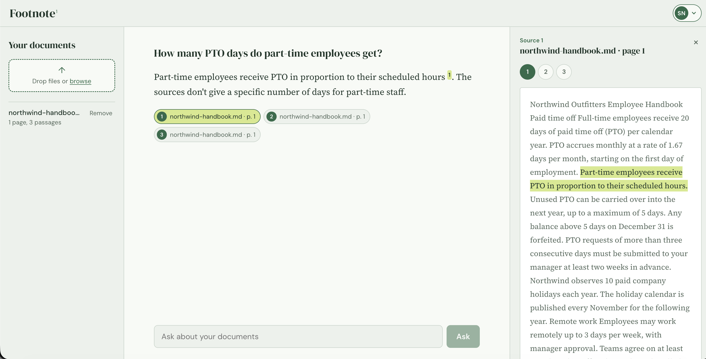
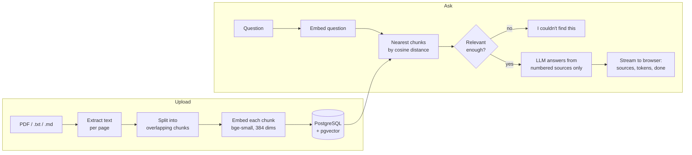
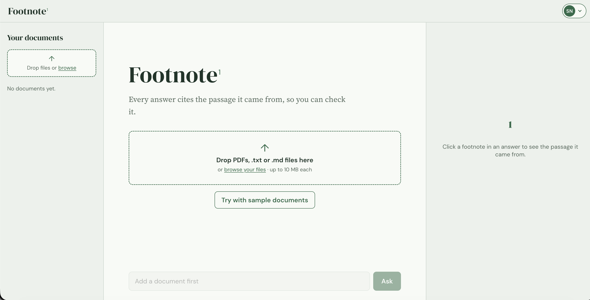
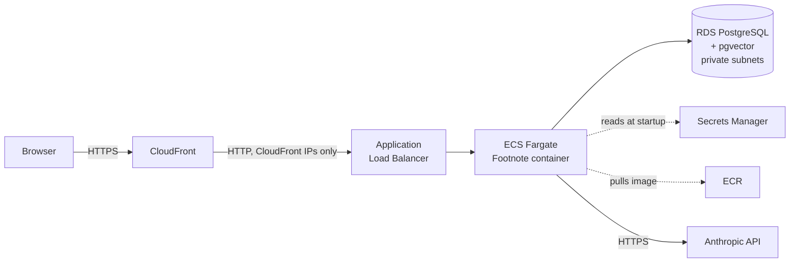
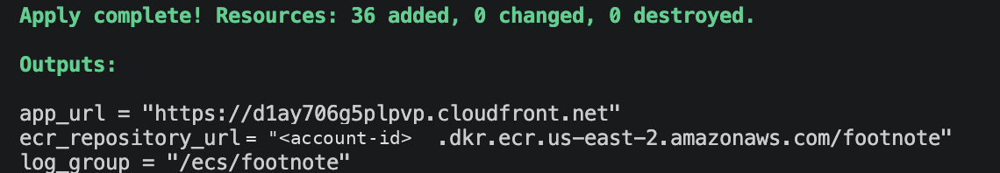
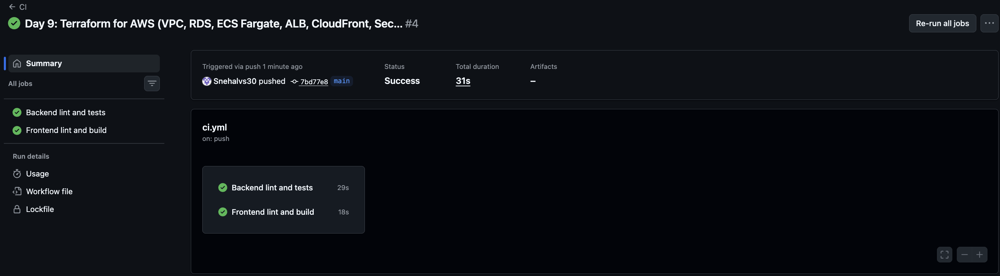

# Footnote

**Ask questions about your documents. Every answer cites the exact passage it came from.**

[](https://github.com/Snehalvs30/footnote/actions/workflows/ci.yml)

Upload PDFs, text or Markdown files, ask a question in plain English, and get an answer that streams in word by word, with numbered footnotes. Click a footnote and the source passage is highlighted, so every claim can be checked. If the answer isn't in your documents, Footnote says so instead of guessing.



*Documents on the left, the conversation in the middle, and on the right the passage behind the selected footnote, highlighted.*

<!-- Demo video: add the link here once recorded -->

---

## Highlights

| | |
|---|---|
| **Grounded answers** | Answers come only from your documents, with a citation on every claim. Unanswerable questions get *"I couldn't find this in your documents."* |
| **Measured quality** | A 26-question evaluation suite: 100% retrieval hit rate (MRR 0.93), 20/20 correct and cited answers, 6/6 correct refusals |
| **Private by design** | Accounts with HttpOnly session cookies. Integration tests prove one user can never see another's documents, through listing, search, or answers. |
| **Tested** | 34 tests (19 unit, 15 integration against a real PostgreSQL via Testcontainers), run by GitHub Actions on every push in about 30 seconds |
| **Deployed with Terraform** | 36 AWS resources: VPC, RDS PostgreSQL + pgvector, ECS Fargate, Application Load Balancer, CloudFront, Secrets Manager, ECR |
| **Swappable LLM** | Claude (Anthropic API), OpenAI, or a free local model through Ollama, chosen with one setting |

---

## How it works



**Ingestion.** Text is extracted page by page and split into chunks of up to 1,000 characters, overlapping by 200 so a sentence cut at a boundary still appears whole in the next chunk. Chunks never cross pages, so every citation points to one exact page. Each chunk is embedded locally with `BAAI/bge-small-en-v1.5` (free, no API calls) and stored in PostgreSQL with an HNSW vector index.

**Answering.** The question is embedded the same way, and the six closest chunks *belonging to the signed-in user* are retrieved. Chunks below a relevance threshold are dropped; if none remain, Footnote answers "not found" without calling the LLM, which is cheaper and leaves nothing to hallucinate from. Otherwise the passages are numbered `[1]`, `[2]`... and sent to the LLM with strict rules: answer only from these sources, cite every claim, never invent a source.

**Streaming.** Answers arrive as Server-Sent Events: a `sources` event first (so the UI can show sources immediately), then `token` events as the model writes, then `done`. The browser's `EventSource` only supports GET, so the frontend reads the POST response stream itself. In the UI, citations become clickable footnote markers; a citation of a source that doesn't exist is shown struck through rather than hidden.

---

## The interface

A three-pane "research desk": your documents, the conversation, and the source behind whichever footnote you select. Each pane scrolls on its own, like a desktop app, and on phones the panes stack and the source panel slides up from the bottom.

| Feature | Details |
|---|---|
| **Source panel** | Clicking a footnote marker or a source chip opens the full cited passage, with the supporting sentence highlighted. The sentence is found in the browser by matching keywords between the passage and the answer sentences that cite it. A highlighter sweep replays for each source (skipped for people who turn off motion in their system settings), and numbered tabs switch between an answer's sources. |
| **Drag-and-drop uploads** | Drop several files at once. Each is checked in the browser first (type, size, empty), then uploads one at a time with real progress, using `XMLHttpRequest` because `fetch` can't report upload progress. |
| **Sample documents** | New accounts can load the evaluation corpus in one click, to try Footnote without their own files |
| **Account menu** | Opens from the initials in the top bar; closes on Escape (returning focus to the button) or a click outside, and works fully from the keyboard |
| **Design** | A light "Library green" palette, with three typefaces given one job each: DM Serif Display for headings, DM Sans for the interface, and Source Serif for answers and sources. Hand-written CSS with design tokens as custom properties; no UI library. |



---

## Evaluating answer quality

Most retrieval-augmented apps can only say *"it answers questions."* Footnote measures how well, with a fixed evaluation set anyone can rerun: three documents about a fictional company (in `backend/eval/corpus/`) and 26 questions, 20 answerable and 6 deliberately unanswerable.

```bash
cd backend
uv run python -m eval.run_eval                   # full run
uv run python -m eval.run_eval --retrieval-only  # retrieval only: fast, no LLM calls
```

| Metric | llama3.2 3B (local, free) | Claude Haiku 5.5 (API) |
|---|---|---|
| Retrieval hit rate (evidence in top 6) | 20/20, MRR 0.93 | 20/20, MRR 0.93 |
| Correct answers | 20/20 | 20/20 |
| Correct answers with valid citations | 20/20 | 20/20 |
| Correct refusals (unanswerable) | 6/6 | 6/6 |
| Invalid citations | 0 | 0 |
| Median time per question | ~3 s | ~1 s |
| Consistent across runs | Only at temperature 0 | Yes |

Retrieval is identical for both because it doesn't involve the LLM; only answer writing differs.

### What the evaluation revealed

- **Randomness was distorting results.** At the local model's default temperature, the share of correct *and* cited answers swung between 16 and 19 out of 20 across identical runs. Setting temperature to 0 made runs reproducible, and only then could changes be compared fairly.
- **A prompt change I expected to help did nothing.** With randomness removed, a stricter citation instruction produced identical results to the original, so I kept the simpler prompt.
- **One "wrong" answer was a wrong test.** The model answered *"you cannot use text message codes"* correctly, but the check expected the exact phrase "not allowed". The checker now accepts alternative phrasings. Tests were only changed where the test, not the answer, was wrong.
- **Similarity scores measure topic, not answers.** Relevance scores of answerable and unanswerable questions overlap (answerable as low as 0.58, unanswerable as high as 0.77): *"What colours does the backpack come in?"* scores high because the FAQ is about that backpack. The threshold filters clearly off-topic questions, but it's the grounding prompt that prevents made-up answers.
- **The benchmark has saturated.** When a 3B local model and Claude both score 100%, the test is too easy to tell them apart. The next step is harder questions (see [Limitations](#limitations-and-next-steps)).

---

## Security

| Concern | How it's handled |
|---|---|
| Passwords | Argon2 hashes; never stored or logged in plain text |
| Sessions | A signed JWT in an **HttpOnly**, **SameSite=Lax**, **Secure** (in production) cookie. JavaScript can't read it, so an injected script can't steal it; other sites can't send requests carrying it. |
| Account discovery | Wrong password and unknown email return the same error, after the same amount of work (a dummy hash is checked), so the login form can't reveal who has an account |
| Data isolation | Every query filters by owner, including vector search in SQL. Another user's document returns 404, not 403, so its existence isn't revealed. |
| Secrets | API keys, the JWT secret and the database URL live in AWS Secrets Manager, read by ECS at container start. The ECS role can read exactly one secret. `.dockerignore` keeps `.env` out of the image; `.gitignore` keeps Terraform state (which contains secrets) out of Git. |
| Network | CloudFront → load balancer → app → database, each layer accepting traffic only from the one in front. The database has no internet route. The load balancer only admits CloudFront's published IP ranges, verified from outside: a direct request times out. |
| Container | Runs as an unprivileged user; ECR scans each image for known vulnerabilities |
| Configuration | Settings are validated at startup; the app refuses to start with a JWT secret shorter than 32 bytes |

---

## Deployment on AWS



One Docker image serves both the API (under `/api`) and the built React app, so the browser talks to a single origin: session cookies just work, with no CORS. The image is built in two stages (Node builds the frontend; only the Python runtime ships), downloads the embedding model at build time so containers start fast, and runs database migrations on startup. CloudFront provides HTTPS without a custom domain. Fargate runs on ARM (Graviton), matching images built on Apple Silicon.

**Deliberate cost trade-offs for a portfolio deployment:** containers run in public subnets with security groups instead of private subnets behind a NAT gateway (about $1/day even when idle), and the database is a single small instance without Multi-AZ. Both are noted as production changes below. The whole stack is created with `terraform apply` and removed with `terraform destroy`; a test deployment of a few hours used only a small fraction of the account's free-tier credits.

<details>
<summary><b>Deploy it yourself</b></summary>

Requirements: an AWS account, the AWS CLI configured, Terraform, Docker, and an Anthropic API key.

```bash
cd infra
export TF_VAR_anthropic_api_key=sk-ant-...   # never put it in a file in the repo
terraform init

# 1. Create the image registry, then push the image to it
terraform apply -target=aws_ecr_repository.app
REPO=$(terraform output -raw ecr_repository_url)
aws ecr get-login-password | docker login --username AWS --password-stdin ${REPO%/*}
docker build --platform linux/arm64 -t ${REPO}:latest ..
docker push ${REPO}:latest

# 2. Create everything else (10-15 minutes; RDS and CloudFront are the slow parts)
terraform apply
terraform output app_url

# 3. Remove everything when done
terraform destroy
```

Set `region` in `infra/variables.tf` to a region your account allows.
</details>



---

## Problems I ran into

**The first deploy was blocked by an organization policy.** Creating the image registry failed with an *explicit deny in a service control policy*, even though my user had AdministratorAccess. The account had been created through AWS's newer sign-up experience, which places accounts in an AWS-managed organization and restricts them to one region. My Terraform targeted `us-east-1`; the account's region was `us-east-2`. Moving the region fixed it.

**A shell quirk renamed my image.** `docker push $REPO:latest` pushed to a repository called `footnoteatest`. In zsh, `:l` after a variable is a modifier meaning *lowercase*, so `$REPO:latest` became `$REPO` lowercased plus `atest`. Writing `${REPO}:latest` fixes it, in any shell.

**The app's first container couldn't read its secrets.** ECS reported that the secret had no value. Terraform had created the ECS service while the database was still being created, and the secret's value contains the database address, so it didn't exist yet. Terraform only knows dependencies you express: the service now explicitly `depends_on` the secret's value.

---

## Testing and CI

```bash
cd backend
uv run pytest        # 34 tests; Docker must be running for the integration tests
uv run ruff check .
```

| Layer | What's tested |
|---|---|
| Unit (19) | Chunking (sizes, overlap, page numbers), embeddings (dimensions, similar sentences closer than unrelated ones), the answer stream (event order, "not found" without calling the LLM, LLM failure ends cleanly), password hashing and session tokens (tampered, forged and expired tokens rejected) |
| Integration (15) | The real API against a throwaway PostgreSQL with the real migrations: sign-up, login and logout; every protected endpoint requires sign-in; upload, list and delete; adding sample documents only once; search; streamed answers; and **user isolation** across every path data could leak |

LLM calls in tests use a fake LLM: free, instant, and deterministic.

GitHub Actions runs two parallel jobs on every push: backend lint and tests (using the exact package versions in `uv.lock`), and frontend lint, type check and production build.



---

## Running locally

Requirements: [uv](https://docs.astral.sh/uv/), Node.js, Docker, and either an Anthropic API key or [Ollama](https://ollama.com) for a free local model.

```bash
# Database
docker compose up -d

# API (http://127.0.0.1:8000/docs)
cd backend
cp .env.example .env              # then set FOOTNOTE_LLM_PROVIDER and a key, or use Ollama
uv sync
uv run alembic upgrade head
uv run fastapi dev app/main.py

# Frontend (http://localhost:5173), in another terminal
cd frontend
npm install
npm run dev
```

To use a free local model instead of an API: `ollama pull llama3.2:3b` and set `FOOTNOTE_LLM_PROVIDER=ollama`.

Once signed in, **Try with sample documents** loads three short documents to ask questions about.

---

## Tech stack

| Area | Choices |
|---|---|
| Backend | Python 3.12, FastAPI, SQLAlchemy 2, Alembic, Pydantic, uv |
| Retrieval | PostgreSQL 17, pgvector (HNSW, cosine), fastembed with `bge-small-en-v1.5` |
| LLMs | Anthropic Claude, OpenAI, or Ollama, behind one interface |
| Frontend | React, TypeScript, Vite, hand-written CSS |
| Auth | Argon2 (pwdlib), JWT (PyJWT) in HttpOnly cookies |
| Testing | pytest, Testcontainers, Ruff, ESLint |
| Infrastructure | Docker, Terraform, AWS (ECS Fargate, RDS, ALB, CloudFront, Secrets Manager, ECR, CloudWatch), GitHub Actions |

---

## Project structure

```
footnote/
├── backend/
│   ├── app/            API, ingestion, retrieval, answering, security
│   ├── migrations/     Alembic database migrations
│   ├── tests/          unit tests, and integration/ against a real database
│   └── eval/           evaluation corpus, questions and runner
├── frontend/           React app
├── infra/              Terraform for AWS
├── Dockerfile          one image: built frontend + API
└── compose.yaml        local PostgreSQL with pgvector
```

---

## Limitations and next steps

- **Harder evaluation.** The current set has saturated. Next: paraphrased questions, answers spanning two documents, and near-miss unanswerables (*"How many PTO days do part-time employees get?"* when the handbook only says "in proportion").
- **More flexible grading.** Keyword checks can fail correct answers worded unexpectedly; an LLM grader would be more flexible, at the cost of money and its own variability.
- **Background ingestion.** Uploads are processed during the request; large documents should be processed by a background worker.
- **The real page in the source panel.** The panel shows the cited passage; the next step is rendering the original PDF page (with pdf.js) and highlighting the passage in place, which means storing original files (on disk locally, S3 on AWS).
- **Scanned PDFs** (images of text) aren't supported; that needs OCR.
- **Production hardening.** App containers in private subnets with a NAT gateway or VPC endpoints; a Multi-AZ database with deletion protection; a secret header between CloudFront and the load balancer (CloudFront's IP ranges are shared by all its customers); Terraform state in encrypted S3 with locking; login rate limiting.
- **Small polish.** Detect duplicate uploads by file hash; start chunk overlaps at a word boundary.